# ProphitBet-v3
ProphitBet is an open-source, AI-powered soccer prediction application designed to analyze 
football matches, evaluate team performance, and predict match outcomes. Specifically, it utilizes 
Machine Learning (ML) techniques, a sub-field of Artificial Intelligence (AI), 
which allows you to construct models that automatically extract patterns between multiple variables 
and predict the outcome of an event. The application provides an end-to-end framework for collecting 
historical match data, computing statistical indicators, analyzing team form, and developing 
predictive models and betting strategies. It supports multiple football leagues, 
integrates historical results and betting odds, and retrieves upcoming fixtures to generate 
predictions for future matches.

Additionally, it features an intuitive Graphical User Interface (gui) that enables you to manage 
datasets, visualize statistical relationships, train and evaluate predictive models, 
and generate predictions without requiring programming knowledge. You can predict 
individual matches or entire sets of upcoming fixtures, apply custom filtering criteria, 
and export results to Excel. The project aims to make advanced ML techniques accessible 
to football enthusiasts, data scientists, and researchers interested in sports analytics, 
predictive modeling, and data-driven betting strategies.

## Step 1 - Python Installatio
**ProphitBet-v3 requires 64-bit Python 3.11.** Other Python versions (3.8, 3.9, 3.10, 3.12, 3.13, etc.) are **not supported** due to compatibility restrictions imposed by the required libraries. 
If you already have other Python versions installed, **you do not need to uninstall them**. Multiple Python versions can coexist on the same computer. Just make sure to use Python 3.11 when installing and running ProphitBet.

### Windows
1. Download **Python 3.11 (64-bit)** from the official Python website: [Download Python 3.11.9](https://www.python.org/downloads/release/python-3119/).
2. Run the installer and make sure to check **"Add Python to PATH"** before proceeding (see the image below).
3. Complete the installation and open Command Prompt (CMD).
4. Verify that Python 3.11 is installed by running the following command:

   ```cmd
   python --version
   ```

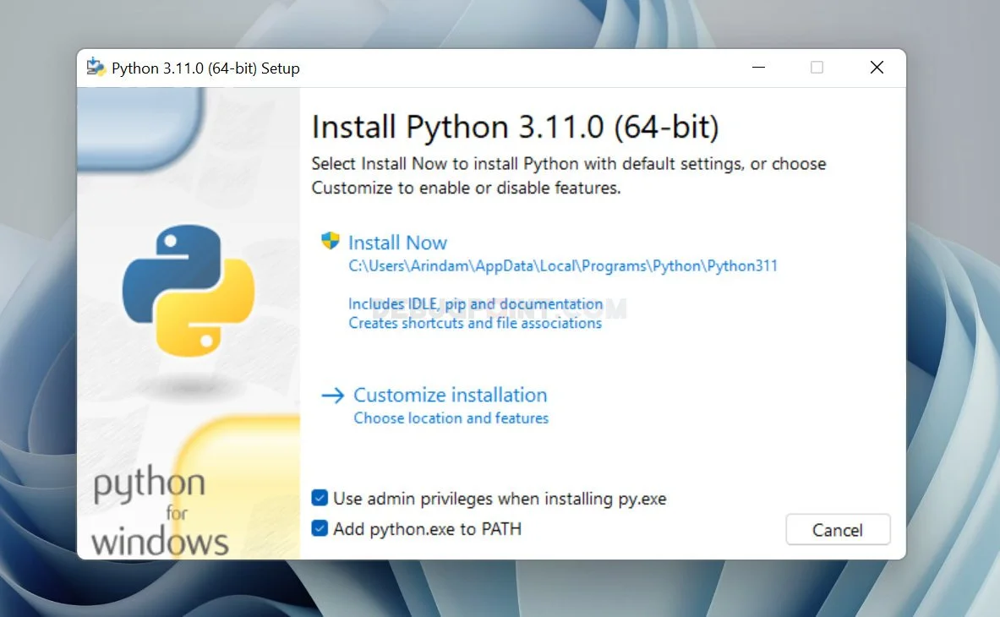
If you are unfamiliar with the installation process, follow this video tutorial:

[](https://www.youtube.com/watch?v=yivyNCtVVDk)

### Linux
ProphitBet-v3 requires **Python 3.11**. On Ubuntu, you can install it using the [Deadsnakes PPA](https://launchpad.net/~deadsnakes/+archive/ubuntu/ppa).

**You can install Python3.11 using deadsnakes/ppa package as follows:**

```bash
sudo apt update
sudo apt install -y software-properties-common
sudo add-apt-repository ppa:deadsnakes/ppa
sudo apt update
sudo apt install -y python3.11 python3.11-venv
```
The `python3.11-venv` package enables the creation of Python 3.11 virtual environments.

**Verify the installation:**

```bash
python3.11 --version
```

The output should display `Python 3.11.x`.

**Video Tutorial**

If you are unfamiliar with installing Python on Linux, follow this video tutorial for Ubuntu:

[](https://www.youtube.com/watch?v=w7v4CZt1po8)

### macOS
1. Download the **Python 3.11 macOS 64-bit universal2 installer** from the official Python website: [Download Python 3.11.9](https://www.python.org/downloads/release/python-3119/).
2. Open the downloaded `.pkg` file and follow the installation instructions.
3. Once installation is complete, open Terminal.
4. Verify the installed version:

   ```bash
   python3.11 --version
   ```
If you are unfamiliar with installing Python on macOS, follow this video tutorial:
[](https://www.youtube.com/watch?v=gycntQ6D7y0)

## Step 2 - Installation of Microsoft Visual C++ Redistributable (Windows Only)
If you are a **Windows** user, you need to install the Microsoft Visual C++ Redistributable (x64 or x86), which can be found here: https://learn.microsoft.com/en-us/cpp/windows/latest-supported-vc-redist?view=msvc-170#latest-supported-redistributable-version

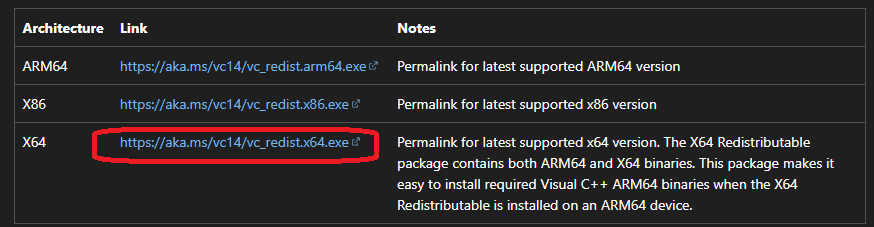
If you need help for the installation, watch this 3-minute guide: 

[](https://www.youtube.com/watch?v=vDpT_CCSNP8)

## Step 3 - Download GraphViz
ProphitBet-v3 requires **Graphviz** to generate and visualize decision trees and other machine learning diagrams.
Graphviz must be installed separately from the Python dependencies. Installing the `graphviz` Python package through `requirements.txt` does not automatically install the Graphviz executable.
You can find the official installation packages and instructions here: https://graphviz.org/download/

### Windows
1. Visit the [official Graphviz download page](https://graphviz.org/download/).
2. Under **Windows**, download the latest stable **64-bit EXE installer**.
3. Run the installer and follow the installation instructions.
4. **IMPORTANT:** During installation, make sure to select the option to **Add Graphviz to the system PATH**.
5. Complete the installation and open a new Command Prompt.

Verify that Graphviz is installed correctly:

```cmd
dot -V
```

The command should display the installed Graphviz version.

**Video Tutorial**

If you are unfamiliar with installing Graphviz on Windows, follow this tutorial:

[](https://www.youtube.com/watch?v=tFkRvuq1qho)

### Linux

On Ubuntu or Debian-based distributions, 
Graphviz can be installed directly using the package manager:

```bash
sudo apt update
sudo apt install -y graphviz
```

For Fedora-based distributions, use:

```bash
sudo dnf install graphviz
```

After installation, verify that Graphviz is available:

```bash
dot -V
```

**Video Tutorial**

If you are unfamiliar with installing Graphviz on Linux, follow this tutorial:

[](https://www.youtube.com/watch?v=FCz5yzVcGdw)

### macOS

On macOS, the recommended installation method is through [Homebrew](https://brew.sh/).
If Homebrew is already installed, open Terminal and execute:

```bash
brew install graphviz
```

Alternatively, visit the [official Graphviz download page](https://graphviz.org/download/) for other installation methods.
Αfter installation, verify that Graphviz is available:

```bash
dot -V
```

The command should display the installed Graphviz version.

**Video Tutorial**

If you are unfamiliar with installing Graphviz on macOS, follow this tutorial:

[](https://www.youtube.com/watch?v=C6oMX7wJ5hM)

### Important Notes
- Graphviz must be installed before running ProphitBet-v3.
- The Graphviz executable (`dot`) must be accessible through the system `PATH`.
- On Windows, if `dot -V` is not recognized, verify that Graphviz was added to `PATH` and restart your terminal.
- Graphviz is a separate system dependency and cannot be installed solely through ProphitBet's `requirements.txt`.

## Step 4 - Download Code
Download the code from the github repository other by clicking on the green "Code" button above selecting Download zip or by copying this address: https://github.com/kochlisGit/ProphitBet-Soccer-Bets-Predictor/archive/refs/heads/main.zip
After the download, unzip the files into your preferred directory (e.g. *Downloads/ProphitBet*)

## Step 5 - Install Python Libraries
ProphitBet requires several Python libraries **(with specific versions)** to run, which are analytically described in `requirements.txt` file. 
If you are an advanced Python user, you can use this file to manually 
install the requirements in whichever environment you like or by typing:

`pip install -r requirements.txt`

If you are a new user or want to automatically install the libraries, you can use the `install.py` script 
to automatically download the required libraries. Open the Command Line (cmd) (or Trminal in Linux). 
In windows, you can open the cmd by typing *cmd* or *Command Prompt* in 
the windows search bar or by pressing the keys *Win+R* and typing *cmd* 
there. Then, nagivate on the created folder (e.g., `cd Downloads/ProphitBet`. 
Finally, type:

`python install.py` 

and press `Enter` to initiate the installation. These libraries will be 
automatically installed to the default Python version. If everything runs perfectly, you will notice an *Installation complete!* 
message along with installation, otherwise it will display an error.

### Using Virtual Environment
If you are an advanced user and would like to install the libraries in a 
specific envrionment, you can also use *python install.py --venv "C:\Users\You\python\envs\myenv"* 
or specify the `VENV_PATH` variable inside the `install.py` script.

## Step 6 - Run Application
To open ProphitBet, you can navigate the CMD to the folder and type `python main.py`. You can also run the application by double-clicking the *app.bat* file (In linux, you can use the *app.sh* respectively). If you have an anti-virus enabled, it is possible that it slows down the initialization of the app.

# Features
ProphitBet-v3 comes with several upgraded features, in comparison to its predecessor, ProphitBet-v2.
If you would like to download the old application, please refer to: https://github.com/kochlisGit/ProphitBet-Soccer-Bets-Predictor/tree/ProphitBet-v2

## Improved Graphical User Interface (GUI)
The new GUI is more lightweight, prettier and faster than ever! It ships with two default system themes:

### Light Theme
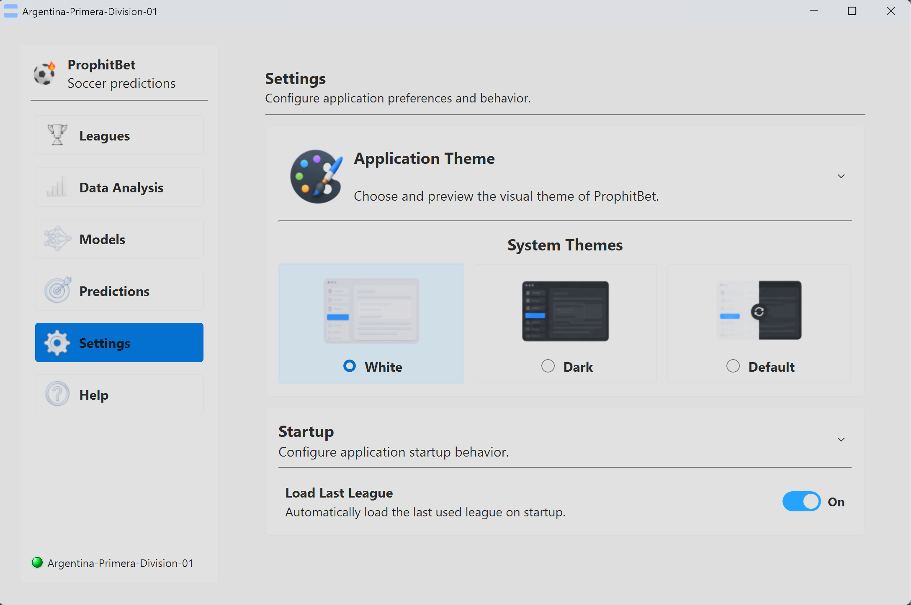

### Dark Theme
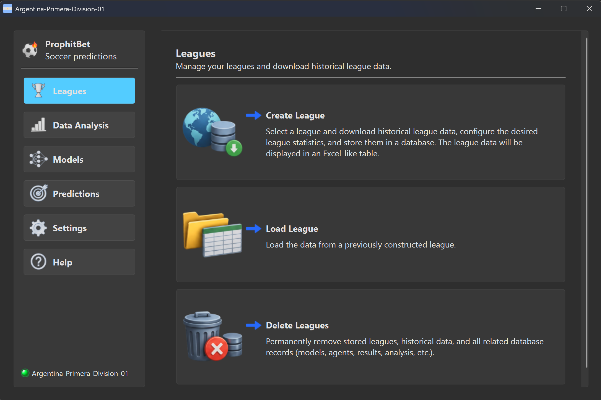

## Creating Leagues
To create a league, navigate to `Leagues/Create League`. Then select a league and provide a unique identifier (id). 
The id is used to save the league and restore it when you re-open the application. Then, you can choose a variety of statistics that you would like to import, along with the historical data range and create the league.
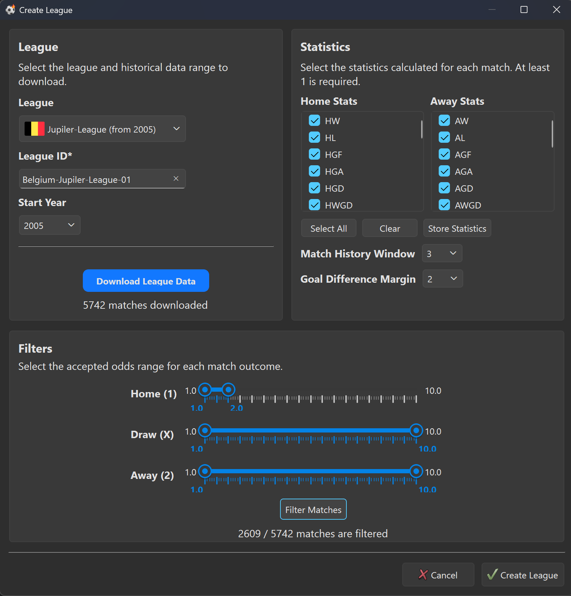
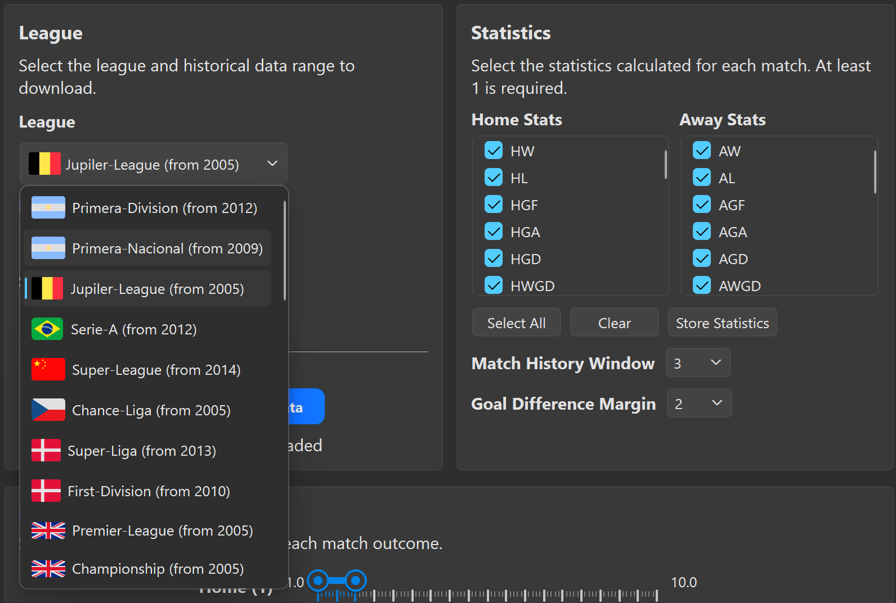

### Supported Leagues
| Country | Name | Working |
|---------|------|:-------:|
| Argentina | Primera-Division | ✅ |
| Argentina | Primera-Nacional | ❌ |
| Belgium | Jupiler-League | ✅ |
| Brazil | Serie-A | ✅ |
| China | Super-League | ✅ |
| Czech Republic | Chance-Liga | ❌ |
| Denmark | Super-Liga | ✅ |
| Denmark | First-Division | ❌ |
| England | Premier-League | ✅ |
| England | Championship | ✅ |
| England | League-1 | ✅ |
| England | League-2 | ✅ |
| Finland | Veikkausliiga | ✅ |
| France | Ligue-1 | ✅ |
| France | Ligue-2 | ✅ |
| Germany | Bundesliga-1 | ✅ |
| Germany | Bundesliga-2 | ✅ |
| Greece | Super-League | ✅ |
| Ireland | Premier-Division | ✅ |
| Italy | Serie-A | ✅ |
| Italy | Serie-B | ✅ |
| Japan | J-1 | ✅ |
| Mexico | Liga-MX | ✅ |
| Netherlands | Eredivisie | ✅ |
| Norway | Eliteserien | ✅ |
| Poland | Ekstraklasa | ✅ |
| Portugal | Liga-1 | ✅ |
| Romania | Liga-1 | ✅ |
| Russia | Premier-League | ✅ |
| Russia | FNL | ❌ |
| Scotland | Premiership | ✅ |
| Spain | La-Liga | ✅ |
| Spain | Segunda-Division | ✅ |
| Sweden | Allsvenskan | ✅ |
| Switzerland | Super-League | ✅ |
| Turkey | Super-Lig | ✅ |
| USA | MLS | ✅ |

You created leagues are automatically stored in your computer and you can restore them anytime by navigation to `Leagues/Load League`. 

### League Creation Tips
* Select a recent historical change (e.g. 2015 or after). Although old seasons can be downloaded, 
training models with old team formations does not often yield the best predictive results.
* Use the filters to select a desired odd range.
* Use the Exploratory Data Analysis tool to analyze the league data and eliminate bad statistical features (variables).

## Excel-Like Table
The new improved excel table if extremely fast and includes several advanced functions, such as:

1. Shows/Hides matches with missing values that are omitted during training.
2. Find/Replaces table values (searches and selects all rows that contain a specific keyword).
   1. Searches and selects all rows that contain a specific-value.
   2. Case-Sensitive search.
3. Copies matches to clipboard using a table-like format. The copied matches can be pasted directly into notepad/excel as well.
4. Standard shortcuts (e.g., CTRL+C, CTRL+V, CTRL+F) for copy, paste and search operations are supported.
5. Highlights selected matches (rows) in the table. 
6. The entire table or the selected/highlighted rows can be extracted into csv or excel files.

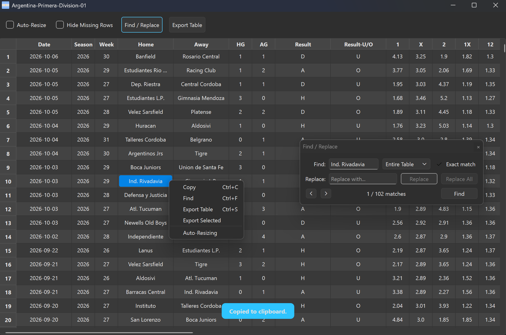
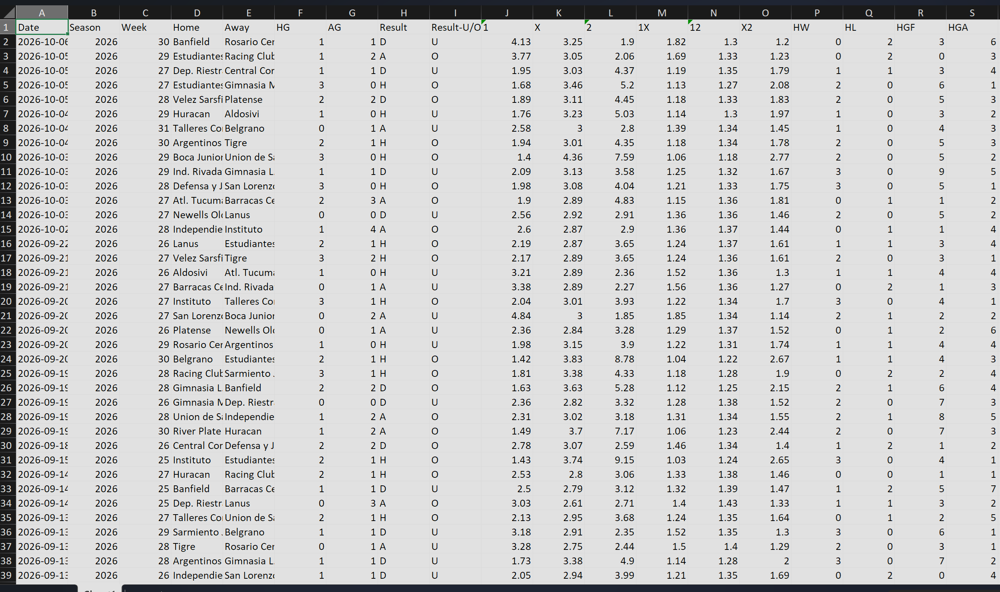

## Exploratory Data Analysis
ProphitBet-v3 includes a variety an advanced data analysis dashboard that you can work with. 
Use it to mainly to analyze  collected matches, filter noisy statistical features and visualize the quality of each variable.
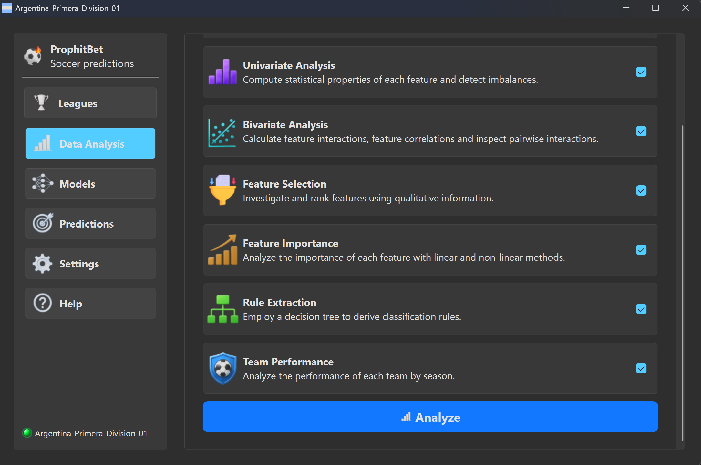


### 1. Dataset Overview
Provides a summary of the selected league, including the number of 
seasons, teams, matches, average goals, and match  outcome statistics. 
An automated alert system identifies potential data quality issues, 
such as missing values and highly correlated or redundant features.
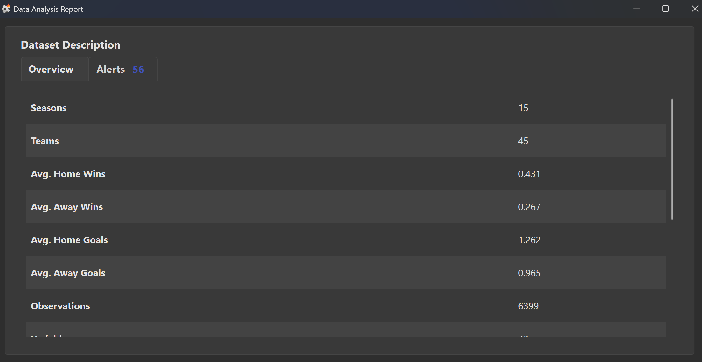
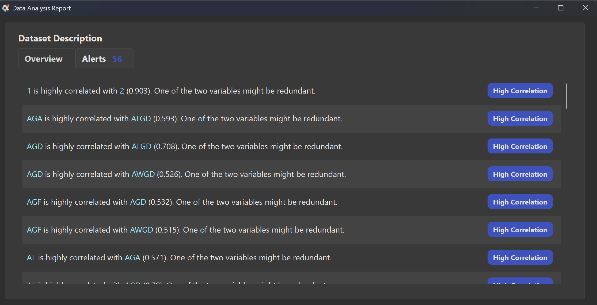

### 2. Univariate Analysis
Examines individual features through descriptive statistics, histograms, 
and probability density estimates. Use this feature to investigate distributions, 
central tendencies, missing values, and other statistical properties 
of each variable.
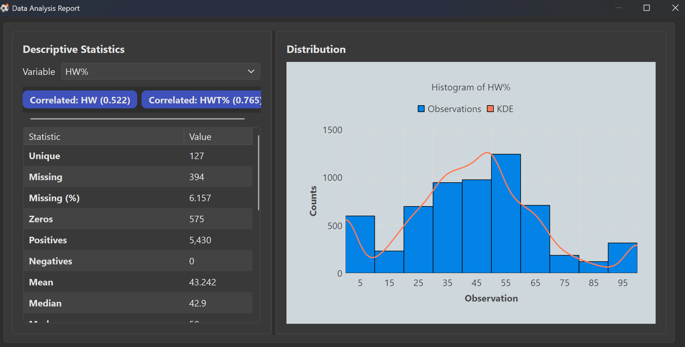

### 3. Bivariate Analysis
Explores relationships between pairs of features using scatter plots, 
correlation coefficients, and interactive correlation heatmaps. 
This analysis helps identify potential redundancies, 
and relationships between football statistics.
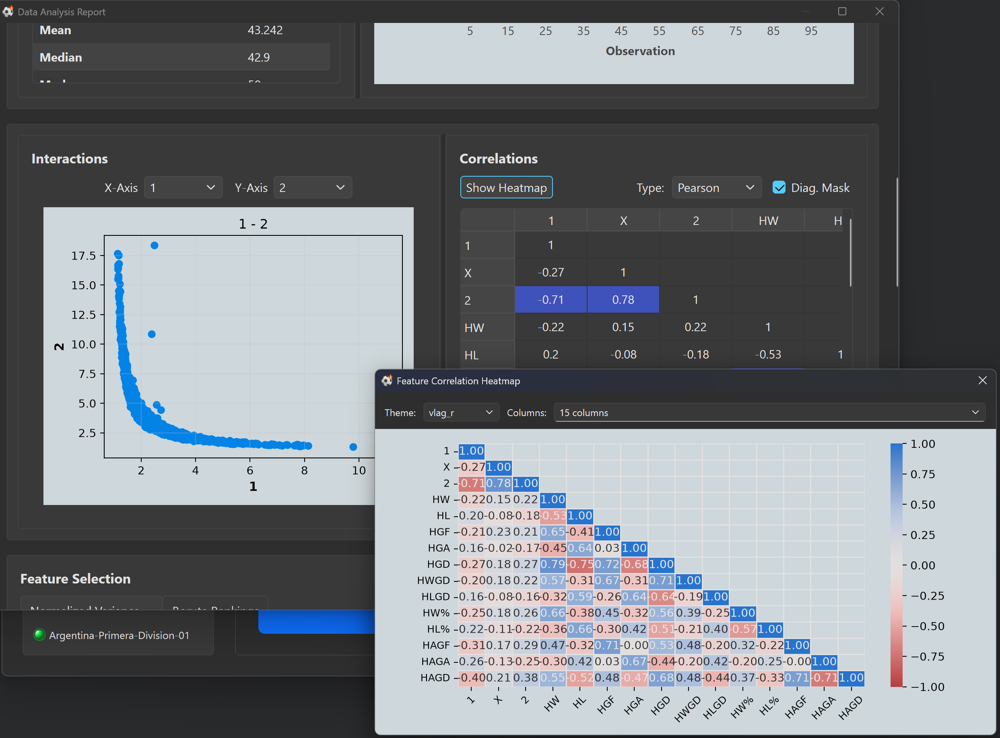

### 4. Feature Selection
Provides feature selection techniques based on normalized variance and 
Boruta rankings. These methods help identify informative features, 
while eliminating the irrelevant ones, and improve the predictive accuracy of the
trained models.
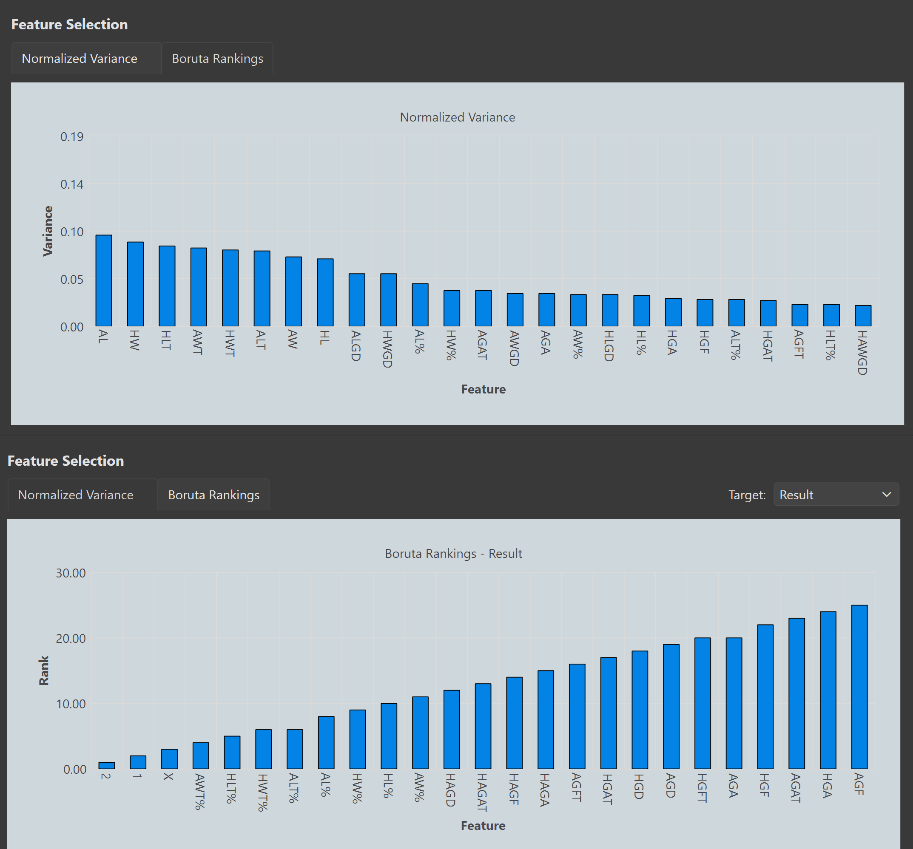

### 5. Feature Importance
Evaluates the contribution of individual features to match outcome predictions 
using linear model coefficients and Gini-based feature importance. These 
visualizations can help you understand which football statistics have the 
greatest influence on the predictive models.
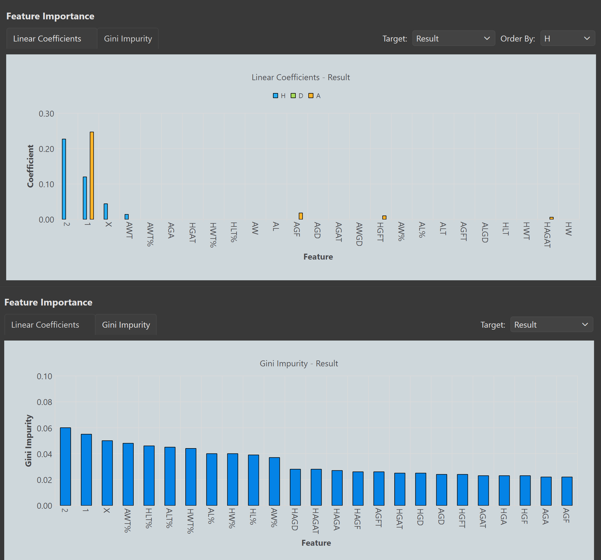

### 6. Tree Rules
Extracts and visualizes decision rules from trained decision trees, allowing 
you to explore the conditions associated with different match outcomes. 
Interactive tree visualizations, leaf distributions, and feature-space 
representations provide insights into the model's decision-making process.
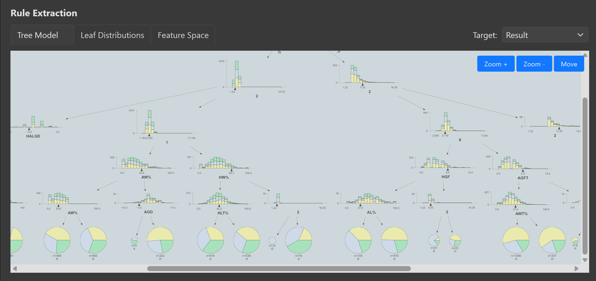

### 7. Team Performance
Provides detailed timeline plots of historical team performance, 
including seasonal trends, cumulative statistics, and comparisons between 
actual and expected match outcomes. You can select individual teams,
seasons, and performance metrics to examine trends and evaluate team 
predictability.
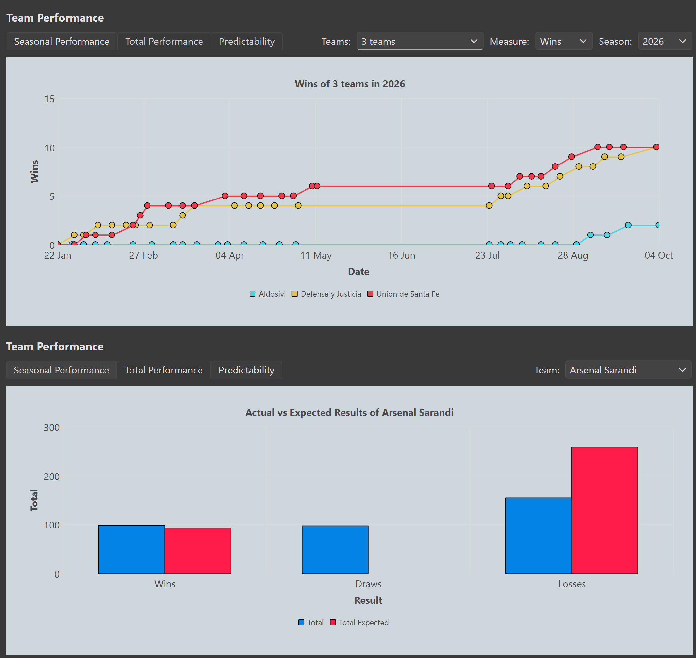

## Training Models

ProphitBet-v3 introduces a re-designed machine learning training framework, 
offering a wider selection of algorithms, extended hyperparameter configurations,
advanced optimization methods, and comprehensive model evaluation. 
The training interface allows You to configure, train, tune, and 
evaluate classification models without writing code.

Compared to previous versions, ProphitBet-v3 introduces **LightGBM**, 
expands the available hyperparameters for each algorithm, and supports 
**parallelized training for most models**, significantly improving 
computational efficiency. Furthermore, training and tuning operations can
now be **canceled at any time**, providing greater control over 
computationally expensive experiments.

### 1. Supported Machine Learning Algorithms

ProphitBet-v3 supports a variety of traditional machine learning and deep learning algorithms, including linear models, probabilistic classifiers, tree-based ensembles, instance-based learning, and neural networks.

| Algorithm | Type | Variance Tendency | Computational Cost             | Description |
|-----------|------|-------------------|--------------------------------|-------------|
| **Logistic Regression** | Linear | Low | Low                            | Probabilistic linear classifier that models the relationship between input features and class probabilities. |
| **Linear Discriminant Analysis (LDA)** | Linear | Low | Low                            | Models class-conditional distributions and identifies linear decision boundaries. |
| **Quadratic Discriminant Analysis (QDA)** | Non-Linear | Medium–High | Low–Medium                     | Extends LDA by allowing each class to have its own covariance matrix, producing quadratic decision boundaries. |
| **Decision Tree** | Non-Linear | High | Low                            | Constructs interpretable decision rules by recursively partitioning the feature space. |
| **Random Forest** | Non-Linear | Low–Medium | Medium–High                    | Combines multiple decision trees trained on randomized data subsets to improve generalization and reduce variance. |
| **XGBoost** | Non-Linear | Medium | Medium–High                    | Gradient boosting algorithm that sequentially builds decision trees to minimize prediction errors. |
| **LightGBM (New)** | Non-Linear | Medium | Medium                         | Efficient gradient boosting framework designed for fast training and scalable learning on structured datasets. |
| **K-Nearest Neighbors (KNN)** | Non-Linear | Medium–High | Low Training / High Prediction | Predicts outcomes based on the labels of the nearest observations in the feature space. |
| **Naive Bayes** | Probabilistic | Low | Low                            | Uses Bayes' theorem and conditional independence assumptions to estimate class probabilities. |
| **Support Vector Machine (SVM)** | Linear / Non-Linear | Medium | Medium–High                    | Identifies separating boundaries by maximizing margins between classes, optionally using non-linear kernels. |
| **Deep Neural Network (DNN)** | Non-Linear | Medium–High | Very High                      | Learns complex feature relationships through multiple neural network layers, with support for attention and variable selection mechanisms. |

*Note: Variance tendencies and computational costs are approximate and depend on the dataset size, number of features, hyperparameters, and available hardware.*

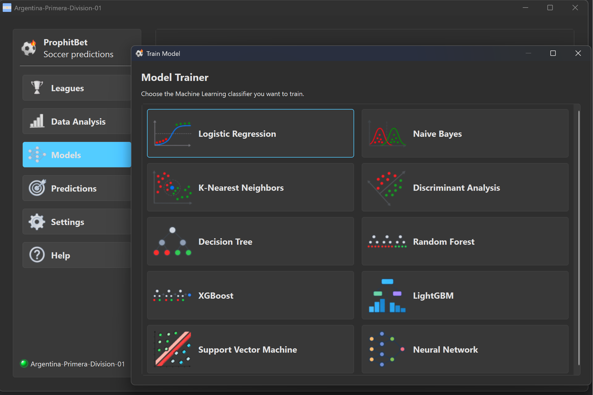

### 2. Hyperparameter Optimization

ProphitBet-v3 integrates advanced hyperparameter optimization techniques 
to automatically identify effective model configurations in short time.
Supported optimization algorithms include:
- **Tree-structured Parzen Estimator (TPE):** A Bayesian optimization approach that models promising and less promising hyperparameter configurations to efficiently guide the search toward better-performing models.
- **Gaussian Process Sampling (GPSampler):** A Bayesian optimization method that models the relationship between hyperparameters and model performance using Gaussian processes, selecting new configurations based on previous evaluation results.

From the Tuning settings, you can specify an optimization objective, 
number of trials, and hyperparameters to optimize. The optimization objectives include:
1. Accuracy Score
2. F1 Score
3. Precision
4. Recall
5. Log Loss (Cross-Entropy)

An interactive **Hyperparameter Tuning Dashboard** is also provided, allowing 
You to monitor and analyze optimization experiments. The dashboard provides detailed visualizations of:
- **Optimization History:** Tracks model performance across trials and highlights improvements throughout the optimization process.
- **Hyperparameter Importance:** Estimates the relative contribution of individual hyperparameters to the optimization objective.
- **Trial Timeline:** Displays the execution time, duration, and status of optimization trials.
- **Trial Details:** Allows You to examine individual trials, parameter configurations, and objective values.

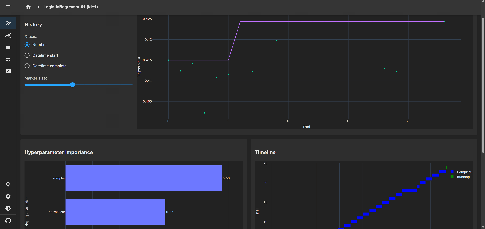

### 3. Model Evaluation
ProphitBet-v3 provides multiple evaluation strategies to estimate model 
generalization to unseen matches and reduce the risk of overfitting.
The supported methods include:
1. **Holdout Validation:** Divides the available data into separate training and evaluation subsets, assessing model performance on observations excluded from training.
2. **K-Fold Cross-Validation:** Splits the dataset into multiple folds and repeatedly trains and evaluates the model, producing a more robust estimate of predictive performance.
3. **Sliding Cross-Validation:** Uses chronological training and evaluation windows to assess model performance over time, similar to backtesting methods in finance.
4. **Nested Cross-Validation:** Employs an inner cross-validation loop for hyperparameter optimization and an outer loop for unbiased performance estimation, reducing selection bias during model evaluation.

The evaluation framework supports multiple classification and probability-based metrics, including 
**Accuracy, F1-Score, Precision, Recall, Log Loss, Brier Score, Ranked Probability Score (RPS), and AUC**, among others.
Furthermore, it provides the Mean Implied Probabilities (MIP) for each odd, and benchmarks 
the model's performance against the odd compilers (skill).
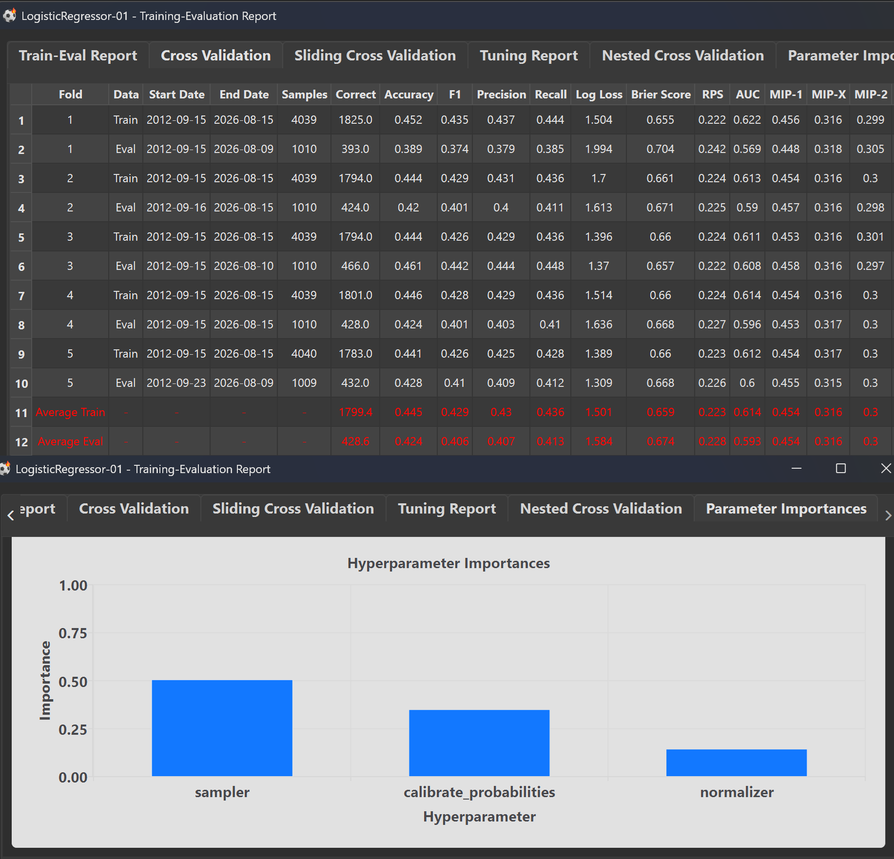

### 4. Prediction Targets
ProphitBet-v3 supports two classification targets:

| Target         | Classes | Description |
|----------------|-------|-------------|
| **Result**     | H/D/A (1/X/2) | Predicts whether the home team wins, the match ends in a draw, or the away team wins. |
| **Result-U/O** | U/O | Predicts whether the total number of goals will be under or over 2.5. |

In case a model is trained to predict the `Result`, ProphitBet-v3 automatically 
computes **Double Chance probabilities** from the predicted match result probabilities:
- **1X (Home Win or Draw):** `P(1X) = P(1) + P(X)`
- **12 (Home Win or Away Win):** `P(12) = P(1) + P(2)`
- **X2 (Draw or Away Win):** `P(X2) = P(X) + P(2)`

## Tips:
* Try to use at least 10% of matches for testing/evaluation.
* Cross-Validation is used to assess the unbiased performance of a model, but the final training uses holdout.
* You don't have to tune all parameters, but if you are not sure about specific model's parameters, you can choose to tune them instead.
* When tuning hyperparameters, the model can become biased towards the evaluation set. In such cases, use Nested Cross-Validation to obtain unbiased validation results.
* Nested Cross-Validation is one of the most reliable evaluation techniques, but it can be quite slow.
* The Fast-Tuning option speeds up the tuning process (4 times faster), but reduces the reliability of the nested cross validation procedure.
* When the targets are imbalanced, use data-sampling techniques and class weight option (if available)!
* The standard scaling algorithm usually works well with most of the algorithms.

## Betting Agents (Deep Reinforcement Learning)
The new version introduces **Deep Reinforcement Learning (DRL) betting agents** which utilize neural networks to learn 
betting strategies through trial and error using historical football data 
and backtesting simulations. Unlike traditional machine learning models 
that predict match outcomes, DRL agents learn which betting actions to 
take by interacting with a simulated betting environment and optimizing 
cumulative rewards. Currently, two advanced reinforcement learning algorithms are supported:
- **Quantile Regression Deep Q-Network (QR-DQN):** A value-based, distributional reinforcement learning algorithm that estimates the distribution of expected returns.
- **Proximal Policy Optimization (PPO):** A policy-based actor-critic algorithm that directly optimizes the agent's decision-making strategy.

Both algorithms support **hyperparameter fine-tuning**, enabling You 
to optimize training configurations and investigate different betting strategies.
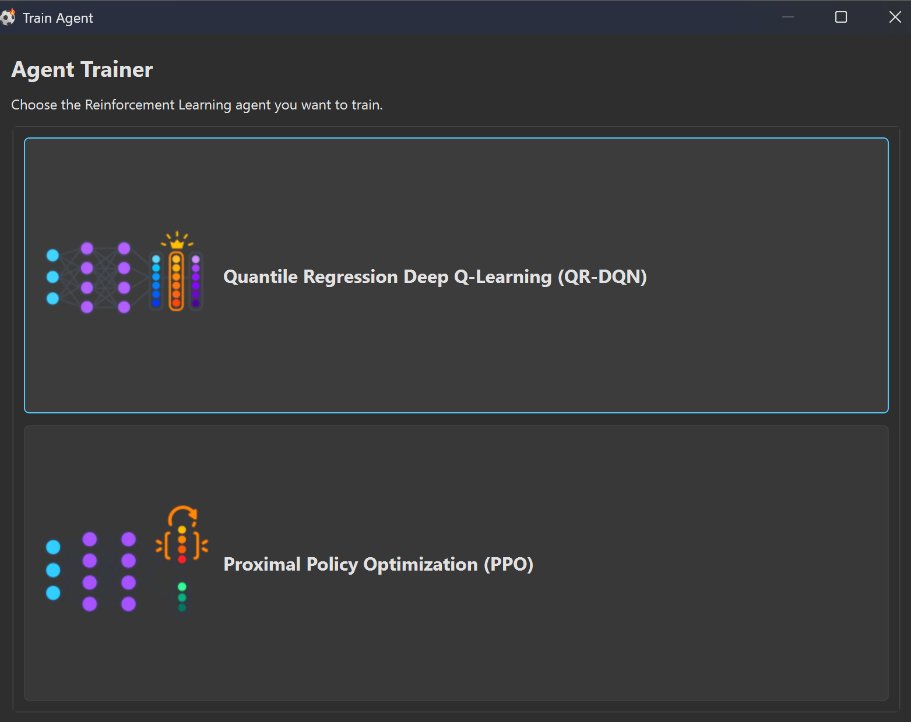

### Supported Betting Actions
Each agent can select among **13 discrete actions**, including skipping a 
betting opportunity, placing individual bets, or constructing accumulator 
bets. Specifically, it supports the following operations:
- **SKIP:** Avoid placing a bet when the agent considers the opportunity unfavorable.
- **SOLO (Single Bet):** Places individual bets that are settled independently according to the selected match outcome.
- **MULTIPLE (Accumulator):** Combines predictions from multiple matches into a single bet. All selections must be correct for the accumulator to win, offering potentially higher payouts at increased risk.

An analytical table of the agent's actions is provided below:

| ID | Action | ID | Action |
|:--:|--------|:--:|--------|
| 0 | SKIP | - | - |
| 1 | SOLO-1 | 7 | MULTIPLE-1 |
| 2 | SOLO-X | 8 | MULTIPLE-X |
| 3 | SOLO-2 | 9 | MULTIPLE-2 |
| 4 | SOLO-1X | 10 | MULTIPLE-1X |
| 5 | SOLO-12 | 11 | MULTIPLE-12 |
| 6 | SOLO-X2 | 12 | MULTIPLE-X2 |

Agents are trained through repeated interactions with historical match data, using betting outcomes and odds to calculate rewards. Through backtesting, agents evaluate different strategies and progressively adjust their decisions to improve long-term performance.
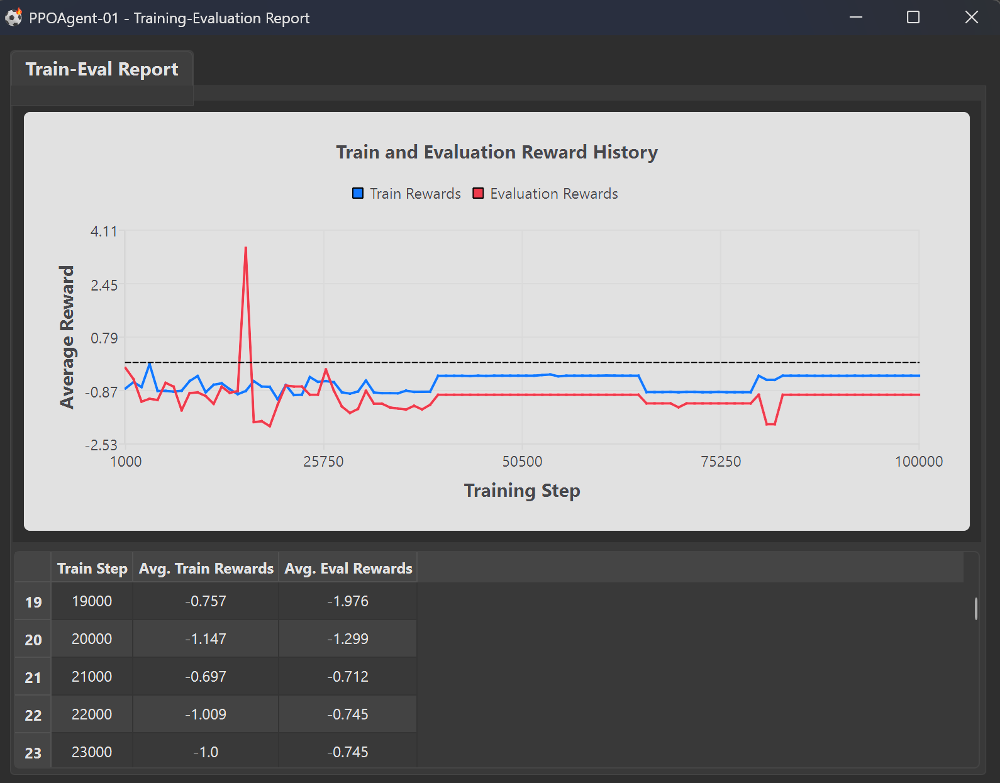

## Evaluating Models
The main purpose of model evaluation is to understand the strengths and weaknesses 
of your models (to understand in which cases/matches your model performs best). 
To achieve this, several tools are provided:
1. Dataset Evaluation: Εvaluate how your model fits in the train (known/seen) data, as well as how your model performs in (unknown/unseen) data that are used for evaluation purposes. The correct matches are automatically highlighted.
2. Prediction filters: Filter the performance of specific model outputs (e.g., matches that were predicted as H)
3. Range filters: Filter the performance of the models based on the specified odd range (.e.g., odd 1 from 1.0 to 1.30).
4. Percentiles: Filter the performance of the models based on their output probabilities (e.g., $prob(1) > 0.3, prob(X) > 0.5, prob(2) > 0.4$, etc.).
5. 
You also have the option to store the filters and utilize them during the 
prediction of the fixtures. Keep in mind that the filters are calculated 
on the specified dataset separately (All/Recent/Train/Eval).
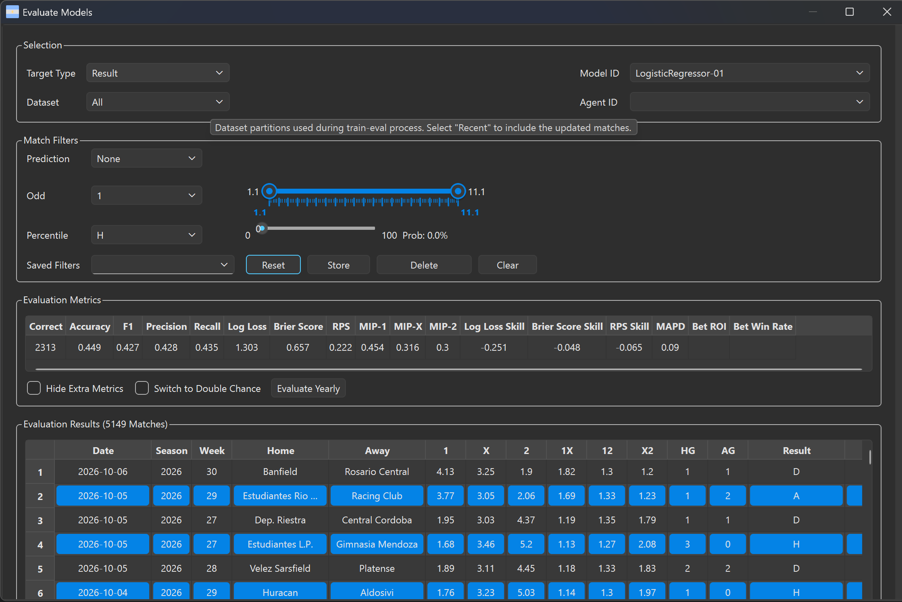
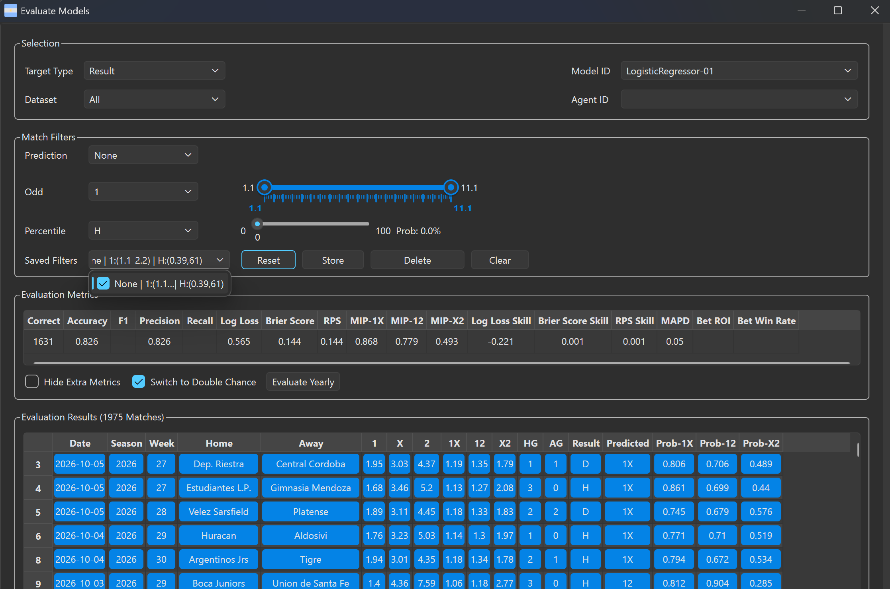

## Predict Matches/Fixtures
You can predict any possible combination of matches you can think of 
(without requiring internet connection). Simply specify 
Home, Away teams and their odds, and select a model or agent to predict the outcome.

Alternatively, you can choose to predict the upcoming fixtures. This mode enables you 
to predict the outcomes of the upcoming league fixtures 
(**requires internet connection**). You just have to specify the 
fixture date and the downlaod will start automatically. **The new ProphitBet-v3 version
does not require Google Chrome to be installed in your computer!**
Then, you can select a model and generate the predictions. By default, 
all predictions are selected (highlighted) for export. 
However, you can also specify the evaluation filters to filter 
specific odd ranges and probabilities. Finally, you can double-click on the
fixture table to edit its values.
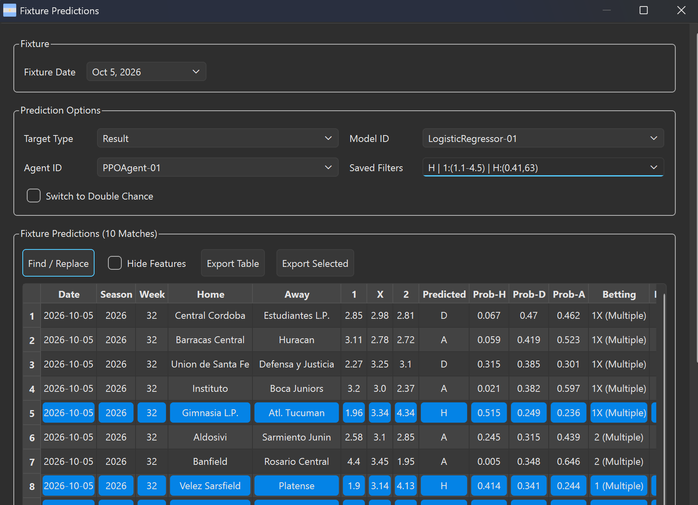

## Help & Support
ProphitBet-v3 introduces a redesigned *elp & Support menu, providing an 
improved learning experience through advanced, enriched tutorials and 
comprehensive documentation covering the application's main 
features and workflows. You can view tutorials automatically 
with a single click, making educational resources easily accessible 
directly from the application. Additionally, the new **Bug Reporting** 
functionality allow You to submit issues and report unexpected behavior 
without leaving ProphitBet, facilitating faster troubleshooting and 
continuous improvements.
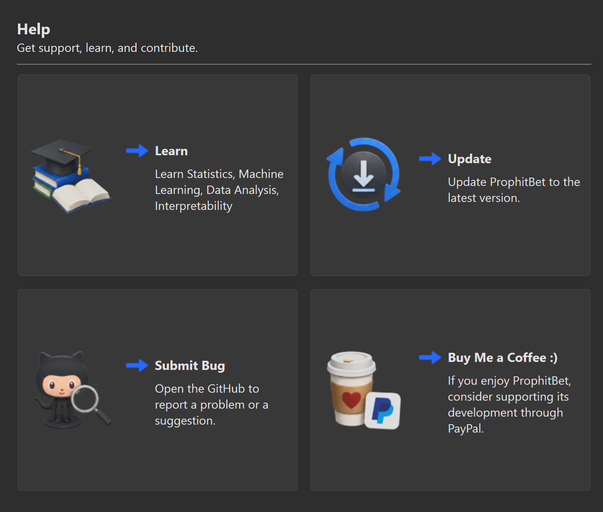

# How to Submit Issue

You can use the issue tab to submit a new issue (or open the url via the app). When submitting an issue, please describe clearly the following:

1. What the issue is.
2. What the application is expected to do
3. What the application does instead.
4. Any error/crash messages appeared in the command line.
5. Reproduction step.

An example of submitted issues that enabled me to quickly detect and resolve the issue can be found here: https://github.com/kochlisGit/ProphitBet-Soccer-Bets-Predictor/issues/111

# Contribution
If you liked the app and would like to contribute, You are allowed to 
make changes to the code and make a pull request! Usually, 
it takes 1-3 days for me to review the changes and accept them or 
reply to you if there is something wrong. Keep in mind that 
I am only a single person working on my free time on this project, 
so please be patient!

# Donation
If you liked the app, you can buy me a coffee via Paypal:

](https://www.paypal.com/donate/?hosted_button_id=AK3SEFDGVAWFE)
or you can scan the QR-Code below:


# Citation
If you are writing an academic paper or conducting research using **ProphitBet-v3**, please cite us!
We provide a [`CITATION.cff`](CITATION.cff) file containing the recommended 
citation information. You can also click **"Cite this repository"** 
in the GitHub sidebar to automatically generate a citation in your 
preferred format, such as BibTeX or APA.

```
@software{prophitBet2024,
  author = {Vasileos Kochliaridis},
  orcid = {0000-0001-9431-6679},
  month = {1},
  title = {{ProphitBet - An Open Source Soccer Prediction App}},
  url = {https://github.com/kochlisGit/ProphitBet-Soccer-Bets-Predictor},
  version = {2.0.0},
  year = {2024}
}
```
